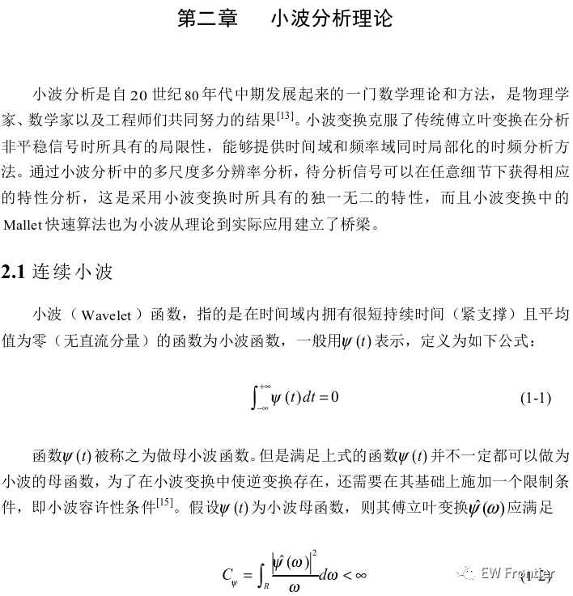
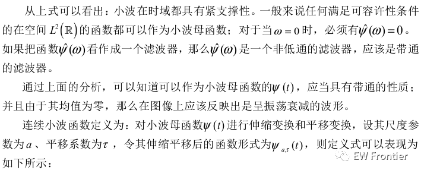
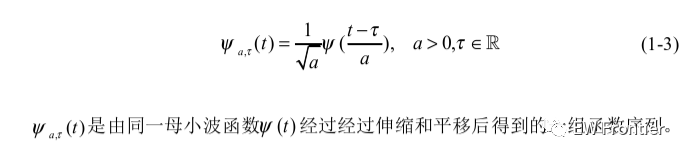
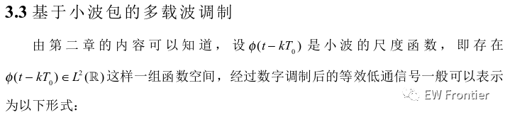
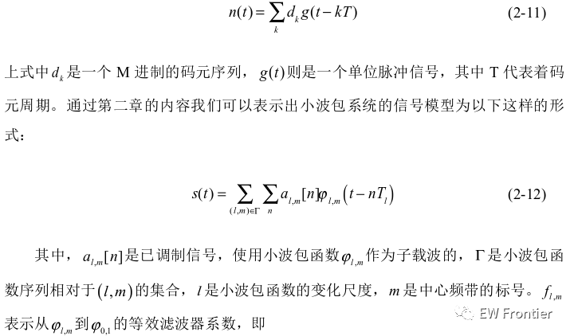
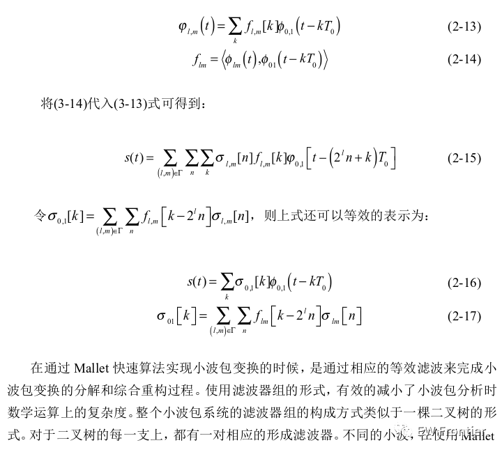
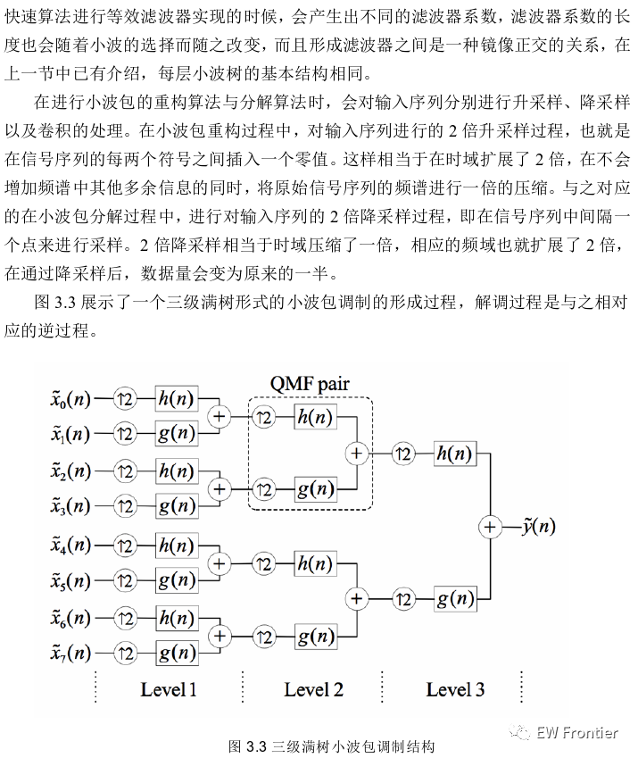
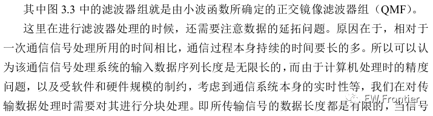
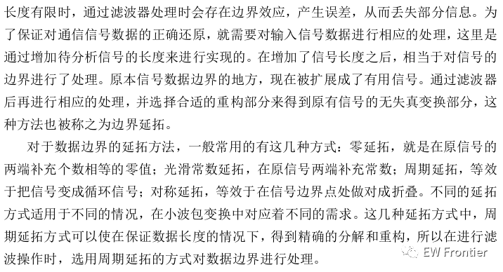

# Multicarrier Modulation Based on Wavelet Transformation (WPM) [With MATLAB Code]

MATLAB code
clear;\nclc;\n​\nNs=8;%Perform 3 wavelet packet decompositions to obtain 8 signals.\npara=128;% The length of each data symbol in the wavelet packet\nN=1024;% The length of the data after wavelet packet inverse transformation\nbit=2;% Bits per symbol\nsignal=round(rand(1,para*Ns*bit));%Source Signal\n​\n% Modulation and serial-to-parallel conversion\ndin2=1-2*signal;\n       din_temp=reshape(din2,2,length(signal)/2);\n       for b=1:length(signal)/2\n           QPSKdata(b)=din_temp(1,b)+j*din_temp(2,b);\n       end\n       complex_qam_data=reshape(QPSKdata,8,length(QPSKdata)/8);\n      x=complex_qam_data;\n      %//////////////////// Implementation of modulation and serial-to-parallel conversion //////////////////////////////\n​\n      \n%////////////////////Displaying the Modified Constellation Map///////////////////////////////\nfigure(1);\nplot(complex_qam_data,'*r');%16qam modulated constellation diagram\naxis([-4,4,-4,4]);\ngrid on\n%////////////////////Displaying the Modified Constellation Map///////////////////////////////\n      \n​\n​\n%/////////////////////wprec module//////////////////////////////////////\n%///////////////////// Third-level refactoring /////////////////////////////////////\n[ld,hd]=wfilters('db1','d');% Calculate the low-pass and high-pass analysis filters of db4 wavelet\nt30=x(1,:);\nt31=x(2,:);\nt32=x(3,:);\nt33=x(4,:);\nt34=x(5,:);\nt35=x(6,:);\nt36=x(7,:);\nt37=x(8,:);\nld3=[ld,zeros(1,N/4-length(ld))];% Third-level decomposition low-pass filter\nhd3=[hd,zeros(1,N/4-length(hd))];% Understanding the third-level decomposition of filters\nlr3=ld3(end:-1:1);\nhr3=hd3(end:-1:1);\nlr3=circshift(lr3',1)';\nhr3=circshift(hr3',1)';\nt30=dyadup(t30);\nt31=dyadup(t31);\nt32=dyadup(t32);\nt33=dyadup(t33);\nt34=dyadup(t34);\nt35=dyadup(t35);\nt36=dyadup(t36);\nt37=dyadup(t37);\nt30=t30(1:length(t30)-1);\nt31=t31(1:length(t31)-1);\nt32=t32(1:length(t32)-1);\nt33=t33(1:length(t33)-1);\nt34=t34(1:length(t34)-1);\nt35=t35(1:length(t35)-1);\nt36=t36(1:length(t36)-1);\nt37=t37(1:length(t37)-1);\nt30=ifft(fft(lr3).*fft(t30));\nt31=ifft(fft(hr3).*fft(t31));\nt20=t30+t31;\nt32=ifft(fft(lr3).*fft(t32));\nt33=ifft(fft(hr3).*fft(t33));\nt21=t32+t33;\nt34=ifft(fft(lr3).*fft(t34));\nt35=ifft(fft(hr3).*fft(t35));\nt22=t34+t35;\nt36=ifft(fft(lr3).*fft(t36));\nt37=ifft(fft(hr3).*fft(t37));\nt23=t36+t37;\n  

## Images

<!-- PAYMENT_BLOCK -->

## Get this dataset

- Payment link (Stripe): [Buy now](https://buy.stripe.com/3cs8yP7sY87d0vu9AB)
- Payment QR code: 

<!-- /PAYMENT_BLOCK -->
